# BetterScreenShot

A Windows screenshot app built with C# and WPF. Created by A. Peda.

For the code structure, release checks, and development pitfalls, see the [project handoff](HANDOFF.md).

## Features

- Choose a monitor or drag an area to capture. Press Esc to cancel.
- Capture a long or wide page by selecting its scrolling area, choosing Vertical or Horizontal, and stopping when finished.
- Record a selected area as an MP4 video or animated GIF from a floating toolbar.
- Per-monitor DPI-aware selection overlays. Area selection is clipped to the monitor where the drag starts.
- Bottom-right preview with Copy, Save copy, Edit, and Discard actions, plus navigation between pending captures.
- After copying, a corner countdown shows when the preview will close. Choose 5, 10, 15, 30, or 60 seconds in **Settings → Capture → Close preview after copying**. The default is 10 seconds; copying again restarts the countdown.
- Save actual PNG, JPEG, or BMP images.
- Screenshot editor with smoothed pen strokes, translucent highlights, underlines, arrows, rectangles, circles, and text. Open or drag a PNG, JPEG, BMP, GIF, or TIFF image onto the launcher or editor to annotate it without changing the original file.
- Open images from File Explorer with **Open with → BetterScreenShot**, including while the app is running in the tray.
- Click annotations to move, resize, recolor, or delete them. Double-click text to edit it; undo and redo work across edits.
- Extract English, Latvian, Lithuanian, Estonian, Swedish, Finnish, and Russian text locally with Tesseract, then select a passage or copy all text.
- Use the sun or moon button in the launcher footer to switch between light and dark themes. Its icon animates when Windows allows motion. The editor's More menu has the same theme switch and can restore the system theme. The manual choice is saved.

## Screenshots

Mark up an image with highlights, editable shapes, curved arrows, and text. The toolbar floats over the image.

| Light theme | Dark theme |
| --- | --- |
| 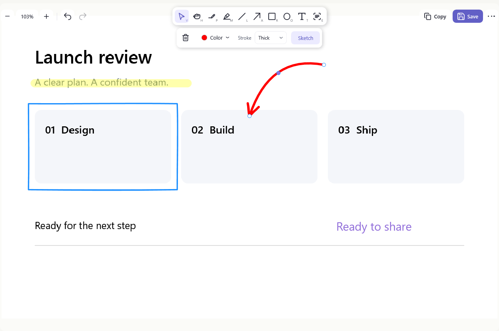 | 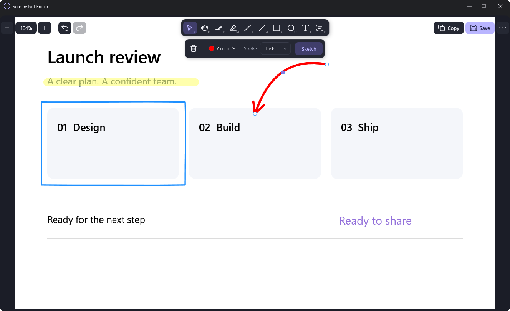 |

Extract text locally and select the matching words on the image and in the results panel.

| Light theme | Dark theme |
| --- | --- |
| 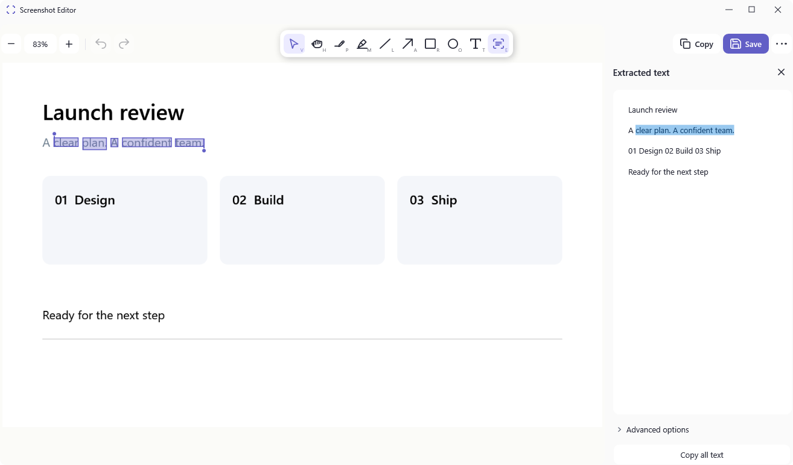 | 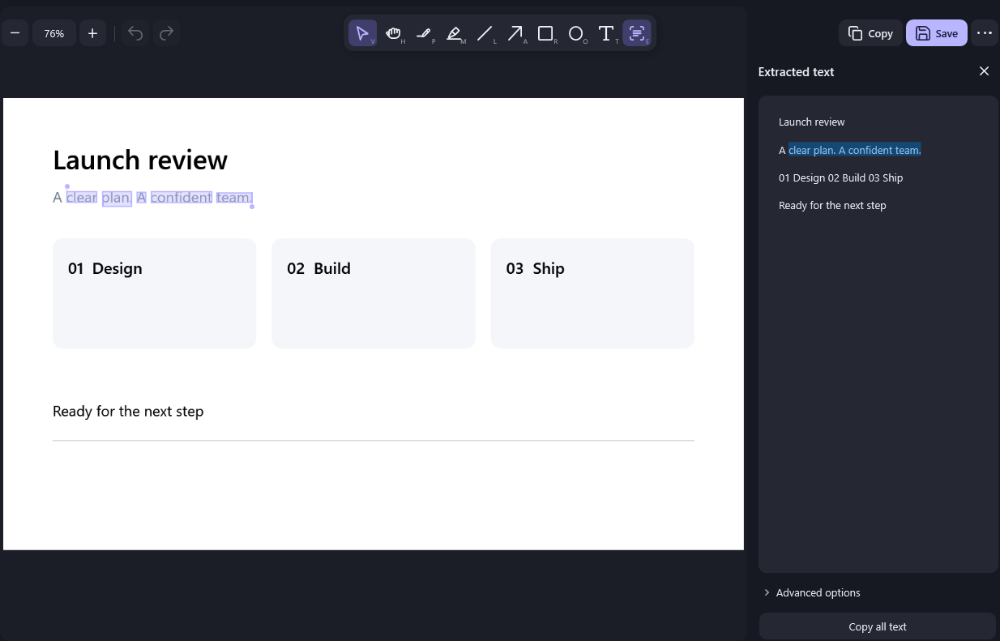 |

The launcher can capture a screen, select an area, capture scrolling content, record an area, or open an existing image. Screenshot previews offer Copy, Save, Edit, and Discard actions.

| Light theme | Dark theme |
| --- | --- |
| 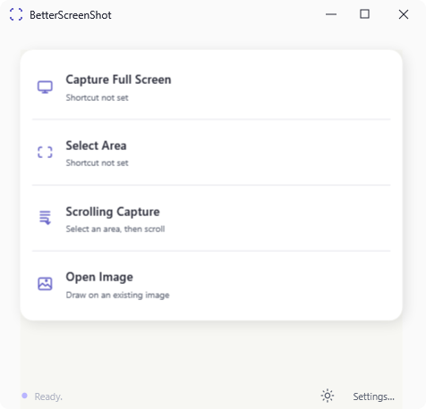 | 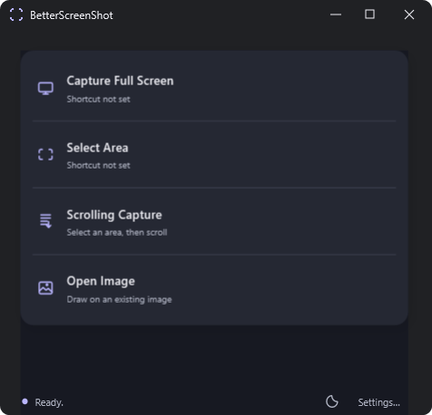 |
| 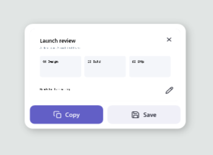 | 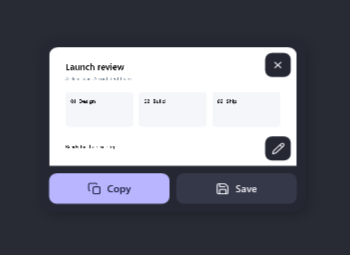 |

### Record an area

Choose video or GIF after selecting an area. The floating controls show the selected video quality before recording, then show the active timer and Stop button. The finished recording has View, Copy, Save, and Discard actions. View opens a player with no editing tools.

| Light theme | Dark theme |
| --- | --- |
| 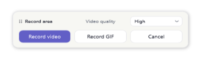 | 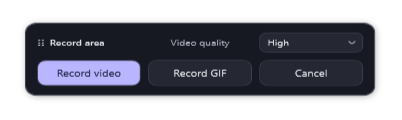 |
| 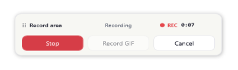 | 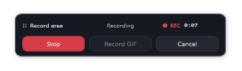 |
| 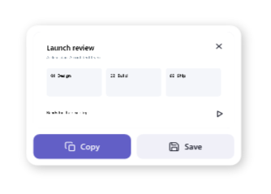 | 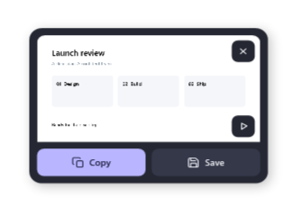 |
| 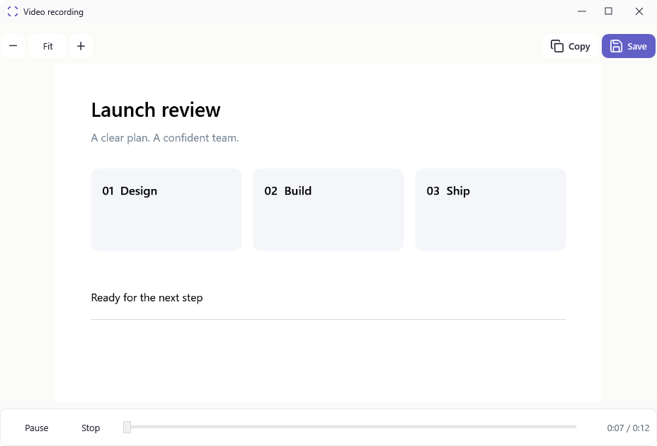 | 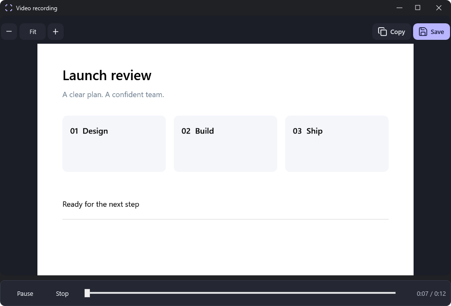 |

Captures are temporary until you choose Save copy. Files live in `%TEMP%/BetterScreenShot` while their preview or viewer is open. New captures preserve earlier previews; use Previous and Next to return to them. Closing a capture notification dismisses it directly without a confirmation and removes its temporary capture; saved copies stay on disk. Opening the viewer transfers ownership to it; closing the viewer removes the temporary file. The screenshot editor closes untouched images directly. If annotations differ from the opening or last successfully saved/copied state, it offers Save copy, Keep editing, and Discard changes. Saved exports remain on disk. For video and GIF, Copy places a file on the clipboard and keeps a copy in `%TEMP%/BetterScreenShot/Copied Recordings` so it remains available for pasting. Cleanup failures are written to the debug output; a crash or a locked file can leave temporary files behind.

## Install on Windows

Download **BetterScreenShot.exe** from the portfolio and double-click it. The executable installs or updates BetterScreenShot in your user profile and opens the installed app. It creates a Start menu shortcut and an Installed apps entry without requiring administrator access or a separate .NET runtime. Existing settings and startup preferences are preserved. A first installation enables startup at sign-in.

Installation registers PNG, JPEG, BMP, GIF, and TIFF images for **Open with**. Right-click an image in File Explorer and choose **Open with → BetterScreenShot**. If needed, select **Choose another app** first. The image opens directly in the editor; the original stays unchanged. To open an image type with a left double-click, choose BetterScreenShot and **Always** in the Windows app picker. Registration keeps your current default image app until you choose to change it. Uninstalling removes BetterScreenShot's Open with entries.

Opening a newer downloaded EXE replaces the older installed version automatically, even if it is running in the tray. The installer waits for open screenshots or recordings to close so they are not discarded. Opening an equal or older installer launches the installed version without downgrading it. You can close the setup window to cancel before replacement. A failed replacement restores the previous executable.

For a ZIP installer package, run `./scripts/Publish-Installer.ps1`, extract `artifacts/BetterScreenShot-win-x64.zip`, and run `Install.cmd`.

The app checks `https://www.aigarspeda.com/downloads/betterscreenshot/latest.json` at startup and every 24 hours while running. A newer version produces a notification and a **Download version…** tray action that saves the portable EXE directly, without opening the portfolio page. In **Settings**, **Check for new version** shows the installed version, the check result, and a download link when an update is available. The tray also has **Check for updates…**. Manual checks share a limit of one per minute, including failed checks and reopening Settings; the button shows a countdown until another check is allowed. Automatic checks run independently of that limit. Tray downloads are checked against the manifest's byte count and SHA256 hash before replacing a chosen file. Network errors during automatic checks stay quiet. Existing builds without the update checker need a manual download once.

To publish a new downloadable version, update `<Version>` in `BetterScreenShot.csproj` and run `./scripts/Publish-PortfolioRelease.ps1 -PortfolioDirectory C:\path\to\portfolio`. This builds the Windows x64 portable EXE and places it with a matching `latest.json` in the portfolio's `public/downloads/betterscreenshot/` folder. Deploy both files together; the portfolio page already links directly to the EXE. Update the size and version shown on the project page if they changed.

Run the downloaded EXE from your normal Windows desktop. An isolated terminal can redirect registry writes, making an installation entry visible to that terminal while absent from Windows Settings. The normal installation records the version, installation date, size, and an uninstall command that starts the app's dedicated uninstall mode.

Closing the launcher keeps the application running. Use its tray menu to open the launcher, configure settings, turn sign-in startup on or off, or Exit. Launching another copy opens the existing instance instead of competing for the same shortcuts.

Keyboard shortcuts keep both existing selection modes: click a monitor for full-screen capture or drag an area. The launcher stays hidden before and after selection. The usual side preview appears with Copy, Save, Edit, and Discard, without taking keyboard focus.

### Scrolling capture

Choose **Scrolling Capture** in the launcher or tray menu, then drag around the content you want. The selected area stays outlined while you capture; its border and the floating Start/Stop/Cancel toolbar are excluded from the image. Drag the toolbar by its title if needed. Choose **Vertical** to scroll downward or **Horizontal** to scroll rightward. Vertical is the default, and the direction is locked after starting. Press **Start capture**, scroll through the area in the chosen direction, and press **Stop capture**. The app matches distinctive overlapping rows or columns and adds only the new content to one image, which opens in the usual preview for copying, saving, or editing. A fixed message box at the bottom or a fixed sidebar at the right is included once at the end. Scroll in steps smaller than one screen so consecutive views overlap. If the toolbar reports no overlap, scroll back until the previous view is visible, then continue more slowly. Visually identical repeated content cannot be aligned reliably and is skipped. Capture is limited to 30 million pixels or 32,000 pixels along the scrolling direction to keep memory use bounded.

This mode captures visible screen pixels along one axis per capture. Moving popups, animations, changing sticky controls, and pages that reflow while scrolling can leave seams or repeated content. Select the scrolling content itself where possible. The app does not scroll other applications automatically.

### Area recording

Choose **Record Area** in the launcher or tray menu and drag around the area you want. In the floating toolbar, choose **Record video** for an H.264 MP4 or **Record GIF** for an animated GIF. Choose **Video quality** before recording: Standard makes smaller files, High is the default, and Maximum favors detail. A red **REC** dot and elapsed time appear while recording, and **Stop** replaces the format button you clicked without shifting the other controls. Press **Stop** to finish or **Cancel** to discard. The selected area stays outlined, and the outline and toolbar are excluded from the recording. The result appears in the usual popup with View, Save, Copy, and Discard. View opens a read-only player sized to the recording, with the editor's layout, Copy and Save at the top, and full-width playback controls at the bottom. Recordings cannot be edited in the app.

Video records visible pixels without audio. Standard uses 15 frames per second; High and Maximum use 30 frames per second with progressively higher bitrates. Slower captures retain their real elapsed duration. GIF records at 8 frames per second, scales selections larger than 640 × 480 pixels to fit, and stops after 20 seconds to bound memory use. Copy places the recording file on the clipboard for pasting into apps that accept files.

During capture, raw rows are stored in `%TEMP%/BetterScreenShot` and deleted when the capture finishes or is canceled. The temporary file can reach about 120 MiB at the 30-million-pixel limit. Finished captures stream from that file into PNG, and the popup holds only a small thumbnail. Copy and Edit load the full image when selected. Saving as PNG copies the original file; converting to JPEG or BMP loads the full image for that export.

Uninstall through Windows Settings → Apps → Installed apps, or run `Uninstall.ps1` from `%LOCALAPPDATA%/Programs/BetterScreenShot`. Uninstalling removes the application and startup entry while retaining saved screenshots and shortcut preferences.

## Portable single executable

Run `./scripts/Publish-Portable.ps1` to create `artifacts/BetterScreenShot-Portable-win-x64/BetterScreenShot.exe`. This separate portable build runs from its current folder and disables automatic installation. Copy just that EXE to another Windows x64 PC and double-click it. It includes the .NET runtime and all application assets, so no installer, companion files, or separate .NET installation are needed. For a Windows ARM64 PC, build with `-Runtime win-arm64` instead. The website download is the one-click installer; launch it with `--portable` to bypass installation for that run.

Use `./scripts/Publish-Portable.ps1 -FrameworkDependent` for the smallest executable. Its output is in `artifacts/BetterScreenShot-Portable-win-x64-FrameworkDependent/` and requires the .NET 8 **Windows Desktop Runtime** for x64 on the destination PC. The base .NET Runtime alone is insufficient.

The self-contained portable and installer builds compress their bundled assemblies. This reduces the EXE size at the cost of some startup decompression. WPF does not support trimming, so these builds keep framework code intact. Native runtime libraries are extracted automatically into the user's temporary cache when needed, and shortcut preferences remain in `%LOCALAPPDATA%/BetterScreenShot`. Running the portable EXE does not add it to Installed apps or enable startup automatically. If you enable Start with Windows in the tray menu, keep the EXE at the same location. Exit the installed copy first if you want to run a different portable build on the same PC; the app normally permits one instance per user.

On the development PC, compression reduced the self-contained EXE from 154.43 MiB to about 68.43 MiB. A framework-dependent EXE is about 0.37 MiB. A relocation check copied each EXE into an empty folder and launched it without companion files. The self-contained check used nonexistent .NET runtime search paths and a fresh native-library extraction cache. Median warmed secondary-instance launch times over three runs were 232 ms for the original EXE, 545 ms for the compressed EXE, and 320 ms for the framework-dependent EXE. These measure runtime startup and single-instance dispatch, not time to show the editor or capture a screenshot. First launches also include extraction and operating-system executable loading, so they can take longer.

## To run locally

1. Open `BetterScreenShot.sln` in Visual Studio.
2. Press `F5` to run the application.

You can also run `dotnet run --project BetterScreenShot.csproj`. Building requires the .NET 8 SDK or a newer compatible SDK on Windows.

## Settings

Click **Settings…** below the capture buttons, in the tray menu, or in the editor's More menu. Capture Full Screen and Select Area each accept a global shortcut. Click a field, press a key combination, then save. Clear disables it. Capture shortcuts start unassigned, work from other applications while BetterScreenShot is running, and are restored on the next launch. They are stored in `%LOCALAPPDATA%/BetterScreenShot/shortcuts.json`.

To use **Shift+Win+S** for Select Area, turn on its separate checkbox in Settings and save. This intercepts the Windows Snipping Tool shortcut while BetterScreenShot runs. Turn the option off or exit BetterScreenShot to restore the Windows behavior. You can keep another Select Area shortcut assigned at the same time.

The settings window also lets you assign a letter to each editor tool. E is reserved for Extract text, and duplicate letters are rejected. Arrow is the starting tool by default. You can choose a different starting tool, or enable **Remember the last-used tool** to reopen the editor with whichever tool you selected most recently. Default annotation color, stroke width, text size, and Sketch outlines apply to new editor windows. Editor preferences are stored in `%LOCALAPPDATA%/BetterScreenShot/editor.json`.

Under **Image quality**, choose **JPEG export quality**: Standard (85), High (95), or Maximum (100). Maximum is the default. Higher values preserve more detail and make larger JPEG files. All choices keep the original pixel dimensions. PNG saves are lossless and are best for sharp text and interface screenshots. Copy provides a full-resolution bitmap and lossless PNG data, including transparency, for applications that support PNG on the clipboard. The receiving application may apply its own compression when pasting or sharing.

The app reports duplicate shortcuts and combinations Windows cannot register, including shortcuts already used by another app. Cancelling the dialog keeps the previous configuration. A shortcut starts the same monitor or area selection as its launcher button; Esc cancels selection.

While a shortcut field is listening, its recorder intercepts key presses and releases before they reach other applications. It stops listening on capture, Escape, Tab, or loss of focus. Ordinary saved shortcuts do not have priority over another app or Windows. If Windows rejects a combination, disable that assignment in the other app or choose a different shortcut. The separate Shift+Win+S option uses a keyboard hook to intercept that Windows shortcut.

## Checks

The regression runner uses the .NET runtime without third-party test packages. Run it on Windows with an interactive desktop:

```powershell
dotnet build BetterScreenShot.sln -c Release
dotnet run --project Tests/BetterScreenShot.RegressionTests.csproj -c Release
```

The checks cover format decoding, failed overwrites, captured pixel colors, frozen preview images, cached theme icons, temporary-file ownership, real selection cancellation and reuse, overlapping selections, launcher layout, and coordinate mapping at 100%, 125%, 150%, and 200% scaling. Tests briefly create selection overlays and preview/viewer windows and remove their fixtures afterwards.

Append `-- --scroll-tests` to run only the vertical and horizontal scrolling checks. They cover exact stitched pixels, fixed bottom/right controls, gaps and reverse movement, repeated content, tiny and invalid frames, capture limits, bounded export memory, cancellation, direction selection, and live screen captures. Use `-- --scroll-preview` to render both directions in light and dark themes under `obj/scroll-preview`.

Use `-- --image-quality-tests` for JPEG quality and file-size comparisons, lossless save/copy pixel checks, transparency, high-DPI images, and quality-setting persistence and validation.

Use `-- --image-open-tests` for Open with registration in an isolated registry subtree, command-line paths with spaces and Unicode, image forwarding to the resident instance, disconnected senders, and editor import cleanup.

To compare full-monitor capture plus cropping with direct area capture:

```powershell
dotnet run --project Tests/BetterScreenShot.RegressionTests.csproj -c Release -- --benchmark
```

The benchmark reads the desktop into memory without saving screenshots. On the development machine, a 1920×1200 monitor and an 800×600 selection averaged 45.06 ms for full-monitor capture plus cropping and 17.52 ms for direct capture over 20 iterations. Capture pixel buffers fell from 11,136,000 to 1,920,000 bytes. These timings exclude PNG encoding and vary with hardware and desktop activity.

The same command also compares preview creation on a synthetic 1920×1200 image. Over 10 iterations, the median time for saving and decoding a PNG was 79.64 ms; copying the pixels directly and saving the PNG took 52.22 ms. This comparison includes saving the temporary PNG and excludes the desktop capture itself. Synthetic fixture files are removed after the run.

For current recording, scrolling, editing, and OCR measurements, including a saved recording baseline and a comparison command, see [Performance baseline](benchmarks/README.md).

Capture uses a compositor flush instead of fixed sleeps, then copies the captured pixels into a frozen WPF image and saves the PNG on a worker thread. Preview, clipboard, and viewer share this image, so the app does not need to read and decode its own PNG. See Microsoft's [DwmFlush reference](https://learn.microsoft.com/en-us/windows/win32/api/dwmapi/nf-dwmapi-dwmflush) and [BitmapSource.Create reference](https://learn.microsoft.com/en-us/dotnet/api/system.windows.media.imaging.bitmapsource.create) for the synchronization and pixel-copy APIs.

## Image editing

Use the markup toolbar or the shortcuts V (select), H (pan), P (pen), M (highlight), L (underline/line), A (arrow), R (rectangle), O (circle/oval), and T (text). Click any annotation to select it, including while another tool is active. Drag it to move it, drag a corner to resize, choose a color or stroke width, or press Delete. Double-click text to edit it. Enter commits text; Shift+Enter adds a line; Esc cancels the current operation.

The centered floating tool dock shares one row with Extract text, Copy, and Save copy when the window is wide enough. In narrower windows, the tool dock moves to a second row. Active tools use a filled state without a border; keyboard focus retains a visible outline. Zoom, undo, and redo sit at the bottom left.

When the editor opens or you select Fit, the image fits to the right of Properties if the panel is visible. Between fits, Properties floats over the current view without shifting or resizing the image. Contextual properties span the available height between the top and bottom controls. Stroke color, stroke width, text size, numbering, and line style appear in labeled groups as needed, with Delete selection anchored at the bottom. Color swatches provide quick choices; **More colors…** includes custom colors. In compact windows, use the Properties button to open the panel. The properties scroll when vertical space is limited. New arrows scale their stroke and arrowhead to stay readable when a large image is fitted into the editor. Run `dotnet run --project Tests/BetterScreenShot.RegressionTests.csproj -c Release -- --ux-tests` to check responsive layouts and unsaved-work behavior and render light/dark fixtures under `obj/ux-review-tests`.

Hold Shift while drawing for squares, circles, or 45-degree lines. Hold Space to pan or Alt to draw over an existing annotation. Ctrl+Z undoes an operation; Ctrl+Shift+Z or Ctrl+Y redoes it. Scroll to zoom and click the zoom percentage to fit the image.

Selected arrows and lines have circular endpoint handles and a purple midpoint. Drag the midpoint to bend the stroke into a curve, or drag either endpoint to change its direction. Curves remain editable and support undo/redo. The Sketch toggle starts enabled and gives shape outlines a hand-drawn style. Turn it off for precise outlines. The setting applies to the whole image, including exports, without changing annotation positions or colors.

New arrows keep the same visible stroke, arrowhead, and number-badge size regardless of the current zoom. Once placed, their dimensions belong to the image and scale with it. Changing zoom alone never changes existing annotations.

The last square in the stroke-color row opens a floating color picker beside the properties panel. Choose a palette color or shade, or enter a six-digit hex code and press Enter or the checkmark. Color changes to a selected annotation support undo. Escape or clicking outside closes the picker.

Right-click an annotation for Delete, Duplicate, and Change Color. Bent lines and arrows also offer Straighten, and text offers Edit Text. Right-click selects the annotation under the pointer. Ctrl+D duplicates the selection; these editing actions support undo/redo.

Click Copy or press Ctrl+C with the canvas focused to copy the image with all current annotations at its original pixel dimensions. Paste it into another application with Ctrl+V without saving a file first. Copy finishes any text being entered and keeps the editor open for further changes. While editing text, Ctrl+C copies the selected text as usual.

Save copy exports the image and annotations together at the original pixel dimensions to PNG, JPEG, or BMP. Successful copy and save actions turn their button green. The editor uses a checkmark in its icon-only buttons; previews and recording viewers show a checkmark and Copied or Saved label. A short slide and fade eases in, pauses for three seconds to remain readable, then eases back to the original label. Button dimensions stay constant, and no success dialog opens. This feedback appears in the editor, capture previews, recording viewer, and text-copy action. Windows reduced-motion preferences disable movement and fades while preserving the reading pause. The open editor keeps its editable objects after exporting. Compositing and encoding run off the UI thread using an independent snapshot, so editing can continue during export. New edits made during a save remain unsaved. Closing an editor with actual changes offers Save copy, Keep editing, and Discard changes; cancelling the file picker keeps it open. Untouched captures, tool/zoom changes, and undoing back to the opening or saved content close without a prompt. Successfully copying the image also allows closing without a prompt. Changes made during or after copying still require another copy or save, or a discard decision.

Run the synthetic 4K annotation benchmark with:

```powershell
dotnet run --project Tests/BetterScreenShot.RegressionTests.csproj -c Release -- --editor-benchmark
```

The benchmark measures gesture cancellation, single-annotation edits, undo/redo, and stroke geometry updates with 300 existing annotations. It measures full-resolution compositing and PNG encoding separately. It reports CPU time and allocations, not display frame rate, and results vary with hardware.

The editor keeps a visual for each annotation. Adding, replacing, or removing a mark updates only that visual; changing Sketch redraws all marks. Cancelling a drag restores only the affected mark. In a local Release comparison with 300 annotations, a single edit fell from 3.99 ms and 3,345 KiB allocated to 0.10 ms and 13.7 KiB. Undo plus redo fell from 7.39 ms to 0.22 ms. These synthetic measurements exclude display presentation.

## Text extraction

Open a capture in the editor, use the **Select** tool, and **double-click a word directly on the image**. Recognition starts automatically, the word is highlighted, and the same word is selected in the text panel. Press **Ctrl+C** to copy just that word. Word highlights follow zoom and pan and are excluded from copied or saved images. Double-clicking an editable text annotation still edits that annotation.

Drag the blue handle at either end of a text selection to include adjacent words or shrink the range. Selections follow reading order across line breaks, so a sentence can span multiple lines. Dragging across the opposite handle reverses the selection direction; Escape restores the range from before the drag. The text panel stays synchronized and Ctrl+C copies the entire selected passage. Handles keep a constant display size when zooming and are excluded from image exports.

| Light theme | Dark theme |
| --- | --- |
| 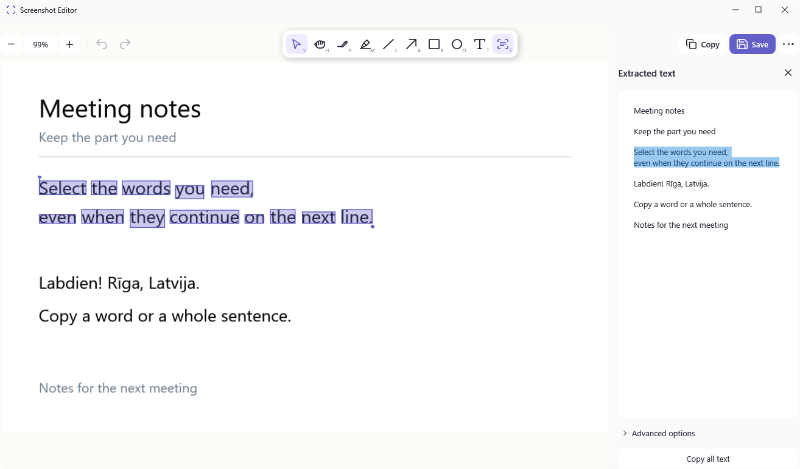 | 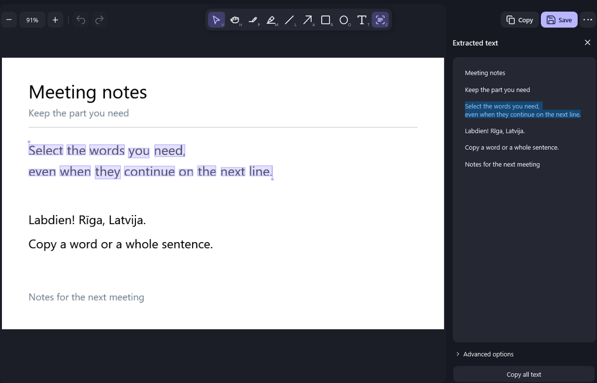 |

You can also click **Extract text**, or press **E** or **Ctrl+Shift+T** with the canvas focused. The button toggles the results panel open and closed, including while recognition is running. Reopening uses cached results when available. In compact windows the text workspace replaces the canvas; **Back to image** returns to editing. Empty results and recognition errors offer Retry. The copy action follows the selection, showing Copy selected text or Copy all text.

Recognition starts in **Auto** mode. For a manual override, expand **Advanced options** below the results and choose English, Latvian, Lithuanian, Estonian, Swedish, Finnish, Russian, or English + Latvian. Choose Auto to restore automatic recognition. The advanced controls start collapsed in each new editor. Double-click a word in the panel or drag to select a passage and use Ctrl+C, or click **Copy all text**. The editor's existing Copy button still copies the image with annotations.

Selecting a passage in the panel highlights every matching word in the image, including selections across lines. The viewer brings off-screen selections into view when zoomed. The panel slides open and closed over 200 ms, respecting the Windows animation setting. Its narrow scrollbar follows the application theme and supports dragging, page clicks, and the mouse wheel.

The editor omits the persistent selection instructions, processing caption, bottom tool hints, and annotation count. Recognition progress, empty results, and errors appear only when needed. Tooltips retain the tool names and shortcuts.

Recognition uses the full-resolution original image without annotations. It runs on a worker thread, caches text and word bounds for Auto and each manual language while the editor is open, and sends no image or text to a server. Closing the panel or editor cancels the pending result; native recognition already in progress may finish in the background. Check recognized text for errors, especially small fonts and complex layouts.

Auto compares recognition passes for all seven bundled languages, chooses a layout by confidence-weighted text coverage, and matches word candidates by their image bounds. This prevents an easy dates-only result from outranking a more complete file list. It uses word confidence and dictionary hints to resolve disagreements, with safeguards for diacritics and Latin/Cyrillic lookalikes. One English pass chooses the working image size before the other Auto passes start. Both Auto and manual recognition retry small text at twice the image size for captures up to four million pixels. Auto needs eight passes for that retry instead of fourteen, retaining the original English result and running all seven models at the chosen size. Word bounds are mapped back to the original image for selection. This is a heuristic, so a manual language can still give a better result. Auto and small-text retries can take longer. The regression fixtures include small dark file lists, all seven languages, and mixed Latin/Cyrillic text.

The first version supports Windows **x64** processes and needs the [Microsoft Visual C++ 2015–2022 Redistributable for x64](https://aka.ms/vs/17/release/vc_redist.x64.exe). If it is missing, the text panel explains how to resolve it. The ARM64 application still builds and runs, but OCR shows an availability message. The x64 application can be used through Windows x64 emulation on supported ARM64 PCs; this has not been tested on ARM hardware here.

The native Tesseract libraries and all seven language models are embedded in the application, including portable single-EXE builds. First use extracts them into `%TEMP%/BetterScreenShot/ocr/<build-id>` and checks cached resources against the embedded SHA256 hashes. Verification and extraction stream resources directly to avoid full-resource memory buffers. Valid cached files are reused, corrupt files are repaired, and failed replacements preserve the original file and remove staging data. Extracted engine files may remain until Windows or the user clears temporary files. Recognized text is kept only in memory, unless copied to the clipboard. Upstream versions and licenses are listed in [third-party notices](THIRD-PARTY-NOTICES.md).

The five additional models total 22.4 MiB before compression: Lithuanian 3.01 MiB, Estonian 4.25 MiB, Swedish 3.97 MiB, Finnish 7.50 MiB, and Russian 3.68 MiB. Manual recognition loads the chosen language. Auto shares one immutable pixel buffer per working size across its language passes. On machines with at least four logical processors, enlarged images and results with at least twelve words use up to half the logical processor count, capped at four independent engines. Short snippets and smaller machines process languages sequentially. A shared request gate prevents multiple editors or rapid panel toggles from accumulating active recognition jobs; waiting requests honor cancellation before starting native work. Active native passes may still finish before cancellation takes effect.

The compressed self-contained x64 EXE grew from 74.41 MiB with English and Latvian to 85.14 MiB with all seven languages, an increase of 10.73 MiB or 14.4% in the measured build.

The regression suite includes real recognition checks for all seven languages, Unicode word offsets, dark backgrounds, blank images, cancellation, original-image extraction, language changes, caching, and closing the editor during extraction. It also checks multiline highlighting, revealing zoomed selections, interrupted panel animations, and scrollbar paging/dragging in both themes. Render light/dark panels at narrow and normal widths with `dotnet run --project Tests/BetterScreenShot.RegressionTests.csproj -c Release -- --ocr-preview`; images are written under `obj/ocr-preview`. Use `--ocr-smoke` for a recognition-only probe, including a relocated single-file regression build.

### OCR performance measurements

Run `dotnet run --project Tests/BetterScreenShot.RegressionTests.csproj -c Release -- --ocr-benchmark` to measure wall time, process CPU time, model initialization, native recognition, pixel conversion, word extraction, merging, and queue waits. Append a quoted image path to also measure a real screenshot. Per-pass measurements, dimensions, recognized text, word bounds, and confidence values are written to `obj/ocr-benchmark.json`. Each fixture and language uses three fresh recognition calls, bypassing the editor's text cache. The console reports medians. Save a copy of the JSON before changing the implementation, then compare it with a second run. Timing callbacks are optional; the normal application does not write a diagnostic log.

The following before/after medians were measured on 2026-10-31 in Release mode on an Intel Core i5-1350P with 16 logical processors. Before uses two concurrent language engines; after allows four. The supplied editor screenshot includes the toolbar and small Explorer filenames. The other fixtures are synthetic. The first call may include asset verification/extraction; subsequent calls reuse the native asset cache. These measurements are not guarantees for other captures or machines.

| Fixture | Mode | Wall time before | Wall time after | Process CPU before / after |
| --- | --- | ---: | ---: | ---: |
| Three large words, 850 × 260 | Auto | 531 ms | 546 ms | 500 / 547 ms |
| Three large words, 850 × 260 | English | 81 ms | 55 ms | 78 / 62 ms |
| Small dark file list, 1000 × 360 | Auto | 2922 ms | 1854 ms | 5234 / 4875 ms |
| Small dark file list, 1000 × 360 | English | 928 ms | 678 ms | 938 / 625 ms |
| Sixteen text lines, 1920 × 1080 | Auto | 5333 ms | 4054 ms | 9219 / 10438 ms |
| Sixteen text lines, 1920 × 1080 | English | 1981 ms | 2225 ms | 1828 / 2078 ms |
| Blank, 850 × 260 | Auto | 339 ms | 272 ms | 547 / 625 ms |
| Blank, 850 × 260 | English | 139 ms | 143 ms | 125 / 125 ms |
| Supplied editor screenshot, 1089 × 776 | Auto | 3609 ms | 2850 ms | 6281 / 7188 ms |
| Supplied editor screenshot, 1089 × 776 | English | 1097 ms | 1055 ms | 1047 / 1016 ms |

Auto wall time fell by 21% on the supplied screenshot, 37% on the file-list fixture, and 24% on the 1080p fixture. More concurrent engines can increase total CPU work and peak memory; screenshot CPU time rose by 14%. Manual recognition and short unscaled snippets use the same execution path as before, so their changes show run-to-run variation. Parallel phase durations are summed work across engines and can exceed elapsed wall time.

The number of recognition passes is unchanged: seven for the large-text Auto fixture, eight for the other Auto fixtures, and one or two for manual English. All 30 before/after results matched exactly, including text, offsets, word bounds, and confidence. Auto retained all six visible filenames in the supplied screenshot, including the visibly truncated name. The full regression suite passed all 85 checks, including small multilingual text, selection, and cancellation.

Run the separate `--ocr-ui-benchmark` mode to measure the editor's dispatcher heartbeat during a 1080p Auto extraction and its cached reopening dispatch. Separate before/after runs took 3971 / 2905 ms, with maximum heartbeat gaps of 47 / 59 ms and 95th-percentile gaps of 35 / 37 ms. Cached reopening dispatched in 0.8 ms in both runs; the panel's 200 ms animation is separate. The raw results are written to `obj/ocr-ui-benchmark.json`.

## Runtime assets

The app draws its window icons and interface icons in code or XAML. `assets/BetterScreenShot.ico` supplies the embedded executable icon used by Windows for shortcuts and Installed apps. It includes sizes from 16 to 256 pixels and can be regenerated with `./scripts/Generate-AppIcon.ps1`. `assets/camera.svg`, used for the capture cursor, is embedded in the assembly. No loose image assets are required.

## Manual display checks

Coordinate tests do not replace checks on physical monitors with different scales. Before release:

| Scenario | Expected result |
| --- | --- |
| Capture the monitor containing the launcher | The launcher and the previous preview are absent from the capture. |
| Cancel either capture mode with Esc, then retry | All overlays disappear, both buttons work, and the previous preview returns. |
| Drag in every direction and past the starting monitor's edges | The captured pixels match the clipped selection. |
| Place 100%, 150%, and 200% monitors left, right, or above the primary monitor | The selection matches physical pixels and the preview appears inside the chosen monitor's working area. |
| Change resolution, scaling, or connected monitors between captures | The next selection uses the updated monitor geometry. |
| Capture repeatedly, open a viewer, then close it | Earlier previews remain accessible; the viewer retains its file until it closes, with a prompt for unsaved screenshot work. |
| Save with each format, copy, zoom, and pan | Saved formats match their extensions, copied images retain full resolution, and viewer controls work. |

Windows DPI awareness is declared in the manifest before windows are created. Toast placement uses physical monitor coordinates and the target window's DPI, following Microsoft's [desktop DPI guidance](https://learn.microsoft.com/en-us/windows/win32/hidpi/high-dpi-desktop-application-development-on-windows).

## Image import performance — 1.2.11

Imported images now keep their decoded pixels in memory without encoding an unused temporary PNG. Saving still produces the full-resolution edited image, and closing/discarding preserves the original. BetterQuickLook 1.0.1 can also send paths directly to the existing image pipe, avoiding a secondary application process.

Measured on this PC on 2026-11-11 with deterministic synthetic 3840×2160 images, one warmup and five samples per format:

| Import-only measurement (median) | 1.2.10 | 1.2.11 |
| --- | ---: | ---: |
| PNG | 745 ms | 144 ms |
| JPEG | 597 ms | 88 ms |
| PNG temporary disk write | 28,366,206 bytes | 0 bytes |
| JPEG temporary disk write | 24,130,391 bytes | 0 bytes |

Managed allocations on the measured thread fell from approximately 28.4 MB to 4.4 KB for PNG and 24.1 MB to 4.5 KB for JPEG. These counters exclude native image buffers; full-resolution decoded pixels still require memory. File creation and explicit garbage collection are outside the timed import operation. These are cached-file microbenchmarks, not application startup measurements. Raw data: `benchmarks/import-before.json` and `benchmarks/import-after.json`.

The final regression suite passed 194 checks, including opening and saving through the editor, PNG/JPEG/BMP/GIF/TIFF imports, Unicode paths, missing/corrupt inputs, source-file release, unchanged originals, and lossless PNG pixel roundtrips. One initial video-duration timing test failed; the unchanged source's recording suite and the final full regression run passed. Existing ImageSharp dependency audit warnings remain.

```powershell
dotnet build .\Tests\BetterScreenShot.RegressionTests.csproj -c Release
.\Tests\bin\Release\net8.0-windows\BetterScreenShot.RegressionTests.exe --import-benchmark .\benchmarks\import-repeat.json
.\Tests\bin\Release\net8.0-windows\BetterScreenShot.RegressionTests.exe --image-open-tests
```

## Cold startup performance — 1.2.12

OCR models and native libraries now live in a separate assembly inside the same EXE. Opening an image populates the language picker without loading that assembly; the first text-recognition request loads it. OCR resource extraction uses the resource assembly's content identity, so unrelated app changes do not invalidate its cache. Capture overlays, initial update checks, and the image-launch tray menu are prepared after the requested editor can appear. Background startup still registers global shortcuts immediately.

Five fresh-process measurements per installed version on 2026-11-11 used the same synthetic 3840×2160 PNG and Windows Shell launch path:

| Launch to visible editor window | 1.2.11 | 1.2.12 |
| --- | ---: | ---: |
| Median cold start | 1,915 ms | 1,577 ms |
| Observed range | 1,702–2,154 ms | 1,380–1,927 ms |

The observed median improved about 18%. The earlier 2.11-second result was one sample; this comparison uses five samples on each side. Warm direct opening in the installed 1.2.12 build had a 311 ms median. These are fresh app processes with existing Windows caches, not reboot or cleared-disk-cache tests. A visible window is detected at 10 ms polling intervals and does not prove compositor completion. First executions of newly built binaries sometimes took 14–31 seconds even before the optimization; these noisy one-off results are retained separately and are not presented as solved.

The main assembly shrank from 38,009,856 bytes to approximately 0.5 MB; the 37.5 MB OCR resource assembly stays unloaded during image opening. This is a structural loading change, not a measured process-RAM reduction. The final self-contained EXE is 90,052,855 bytes and has no companion files. Full assembly extraction and an uncompressed 201 MB EXE were evaluated but not retained. Microsoft documents the compression/startup tradeoff in its [single-file deployment guidance](https://learn.microsoft.com/en-us/dotnet/core/deploying/single-file/overview).

Validation: three fresh-process startup tests pass in both ordinary and single-file test builds, including closing before idle warmup. The packaged OCR smoke test recognizes its synthetic text. The full regression run passed 193 of 194 checks; one settings-file rename hit a transient access error, and all 11 image-quality checks passed on the targeted rerun. OCR, capture, shortcuts, image saving, and editor lifecycle checks passed. Existing ImageSharp audit warnings remain.

Raw timing files are in `benchmarks/cold-repeat-before.json`, `cold-installed-after.json`, and `cold-update-warm-check.json`. The BetterQuickLook project retains the other experiment reports and the launch benchmark. BetterScreenShot 1.2.12 is installed, its hash matches the published EXE, and startup remains enabled. BetterQuickLook's production code is unchanged.

```powershell
dotnet build .\Tests\BetterScreenShot.RegressionTests.csproj -c Release
.\Tests\bin\Release\net8.0-windows\BetterScreenShot.RegressionTests.exe --startup-tests
.\Tests\bin\Release\net8.0-windows\BetterScreenShot.RegressionTests.exe --ocr-smoke
```

## Responsive image loading — 1.2.13

Imported images now decode on a worker thread while WPF constructs and displays the editor. The same window shows a themed loading state, filename, and Cancel button; its position and size do not change when the image arrives. Editing, copy, save, and OCR are blocked until the real pixels are ready. Missing/corrupt files show an inline error. Closing cancels queued decoding and discards any late result without reopening the window or touching the original file. An already-running native decode finishes on its worker before releasing its resources.

One native decoder runs at a time to bound temporary CPU and memory costs across multiple opens. The UI thread continues to handle rendering and input. This uses parallel work where it helps; it does not reserve all cores, fill available RAM, or add an idle polling loop. The progress animation stops after completion, failure, or close. Fast files do not receive an artificial loading delay.

Five-run medians for the same synthetic 4K PNG, comparing installed 1.2.12 and 1.2.13:

| Milestone | 1.2.12 | 1.2.13 |
| --- | ---: | ---: |
| Cold: window visible | 1,342 ms | 1,213 ms |
| Cold: decoded image assigned and editing enabled | 1,342 ms | 1,282 ms |
| Warm: window visible | 224 ms | 145 ms |
| Warm: decoded image assigned and editing enabled | 224 ms | 251 ms |

The earlier window is real feedback, not a claim that decoding has finished. Warm image readiness was 26 ms slower in this run; the early frame and UI transition have costs, and machine load varies. Cold means a fresh process with existing Windows caches. Readiness is detected from the document title changing out of its loading state, at 10 ms polling resolution; it is not a compositor/GPU completion measurement. The baseline includes a one-off 11.9-second launch; all raw samples remain in the reports. No claim is made to eliminate those first-launch delays.

The 194-check regression suite passed. Six additional async-loading tests cover responsive input, placeholder-save prevention, close during success/failure, missing/corrupt files, out-of-order completion, queued cancellation, and decoder-gate release. After starting decoding earlier in construction, the six loading tests, seven image-open groups, and three startup tests were rerun successfully. The dark loading state was rendered and visually inspected. Installed 1.2.13 matches the final published EXE; code is uncommitted.

Raw results: `benchmarks/async-window-before-cold.json`, `async-window-after-cold.json`, `async-window-before-warm.json`, and `async-window-after-warm.json`.

```powershell
dotnet build .\Tests\BetterScreenShot.RegressionTests.csproj -c Release
.\Tests\bin\Release\net8.0-windows\BetterScreenShot.RegressionTests.exe --image-loading-tests
```

## Startup research follow-up

Source inspection of [qView](https://github.com/jurplel/qView/blob/main/src/qvimagecore.cpp) and [JPEGView](https://github.com/sylikc/jpegview/blob/master/src/JPEGView/JPEGProvider.cpp) supports background decoding and bounded image caching. The current editor already shows its window while decoding; neighboring-file preloading was not added because opening isolated files gains little from it and decoded images consume extra RAM. Full-resolution editing and current color handling remain intact.

An additional [ReadyToRun](https://learn.microsoft.com/en-us/dotnet/core/deploying/ready-to-run) publish experiment was slower on this computer. Across ten fresh-process launches per build, median window visibility was 1,265 ms for current 1.2.13 versus 1,603 ms for ReadyToRun; image readiness was 1,300 ms versus 1,744 ms. The compressed EXE grew from 90,056,723 to 102,153,589 bytes. The experiment was not retained. This was direct process launching with existing Windows caches, not a reboot-cold or Shell-handler comparison. A 28.4-second first candidate execution remains in the raw data. The reverse-order repeat also favored the current build.

The four `benchmarks/research-r2r-*.json` files retain every sample. The BetterQuickLook benchmark README contains the research sources, decisions, build flags, and measurement details. Installed 1.2.13 remains the tested production build; this experiment did not change production source or the installed executable.
