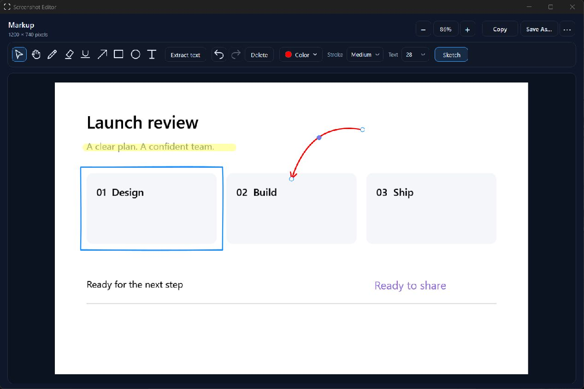
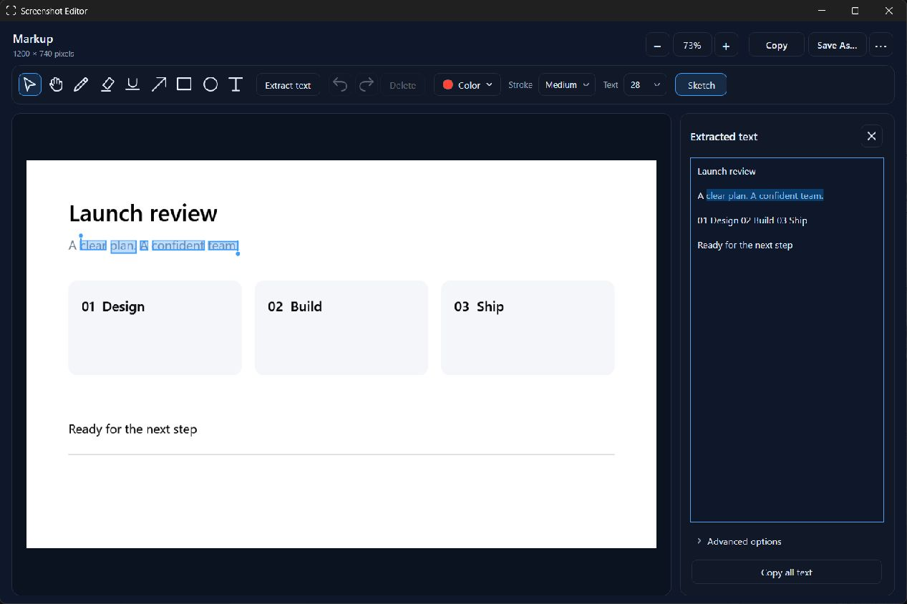
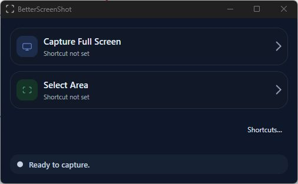
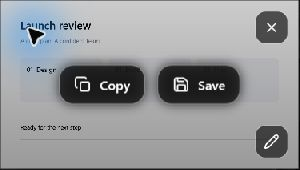
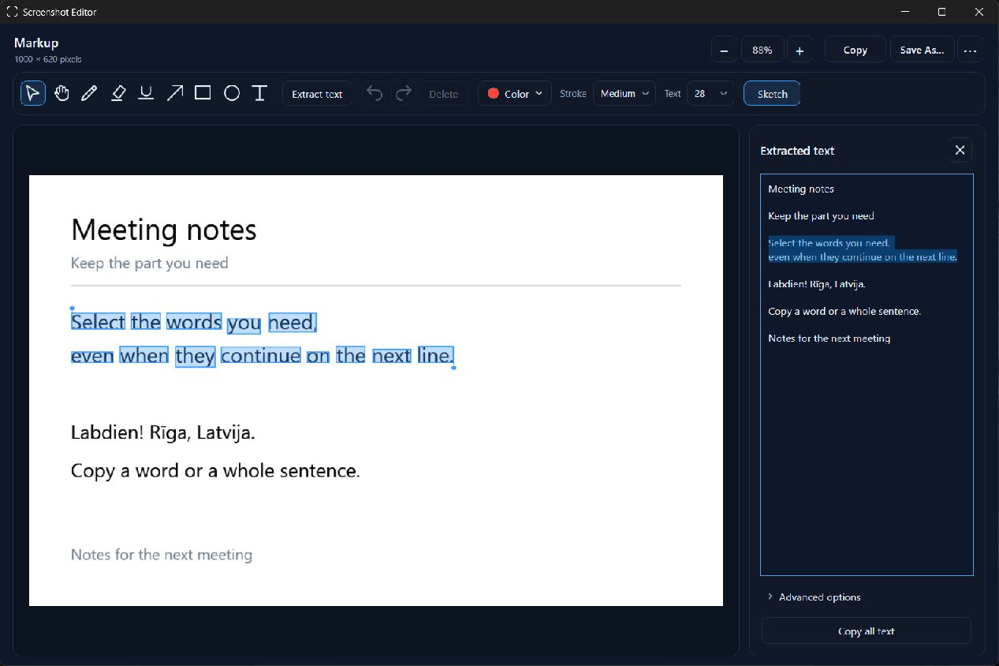

# BetterScreenShot

A Windows screenshot app built with C# and WPF. Created by A. Peda.

For the code structure, release checks, and development pitfalls, see the [project handoff](HANDOFF.md).

## Features

- Choose a monitor or drag an area to capture. Press Esc to cancel.
- Per-monitor DPI-aware selection overlays. Area selection is clipped to the monitor where the drag starts.
- Bottom-right preview with Copy, Save, Open Viewer, and Discard actions.
- Save actual PNG, JPEG, or BMP images.
- Screenshot editor with smoothed pen strokes, translucent highlights, underlines, arrows, rectangles, circles, and text.
- Click annotations to move, resize, recolor, or delete them. Double-click text to edit it; undo and redo work across edits.
- Extract English, Latvian, Lithuanian, Estonian, Swedish, Finnish, and Russian text locally with Tesseract, then select a passage or copy all text.

## Screenshots

Mark up a screenshot with highlights, editable shapes, curved arrows, and text, then copy it directly to another app.



Extract text locally, then select the same passage in the image and the results panel.



| Capture a screen or area | Preview and quick actions |
| --- | --- |
|  |  |

Captures are temporary until you choose Save. Files live in `%TEMP%/BetterScreenShot` while their preview or viewer is open. Replacing or closing a preview removes its file. Opening the viewer transfers ownership to it; closing the viewer removes the temporary file. Copies saved with Save As remain on disk. Cleanup failures are written to the debug output; a crash or a locked file can leave temporary files behind.

## Install on Windows

Build a self-contained package with `./scripts/Publish-Installer.ps1`. Extract `artifacts/BetterScreenShot-win-x64.zip` and run `Install.cmd`. The installer adds the application to your user profile, creates a Start menu shortcut, enables startup at sign-in, and starts it quietly in the tray. It does not require administrator access or a separately installed .NET runtime. Existing capture shortcuts are preserved.

Run `Install.cmd` from File Explorer in your normal Windows desktop. An isolated terminal can redirect registry writes, making an installation entry visible to that terminal while absent from Windows Settings. The normal installation records the version, installation date, size, and an uninstall command that starts the app's dedicated uninstall mode.

Closing the launcher keeps the application running. Use its tray menu to open the launcher, configure keyboard shortcuts, turn sign-in startup on or off, or Exit. Launching another copy opens the existing instance instead of competing for the same shortcuts.

Keyboard shortcuts keep both existing selection modes: click a monitor for full-screen capture or drag an area. The launcher stays hidden before and after selection. The usual side preview appears with Copy, Save, Edit, and Discard, without taking keyboard focus.

Uninstall through Windows Settings → Apps → Installed apps, or run `Uninstall.ps1` from `%LOCALAPPDATA%/Programs/BetterScreenShot`. Uninstalling removes the application and startup entry while retaining saved screenshots and shortcut preferences.

## Portable single executable

Run `./scripts/Publish-Portable.ps1` to create `artifacts/BetterScreenShot-Portable-win-x64/BetterScreenShot.exe`. Copy just that EXE to another Windows x64 PC and double-click it. It includes the .NET runtime and all application assets, so no installer, companion files, or separate .NET installation are needed. For a Windows ARM64 PC, build with `-Runtime win-arm64` instead.

Use `./scripts/Publish-Portable.ps1 -FrameworkDependent` for the smallest executable. Its output is in `artifacts/BetterScreenShot-Portable-win-x64-FrameworkDependent/` and requires the .NET 8 **Windows Desktop Runtime** for x64 on the destination PC. The base .NET Runtime alone is insufficient.

The self-contained portable and installer builds compress their bundled assemblies. This reduces the EXE size at the cost of some startup decompression. WPF does not support trimming, so these builds keep framework code intact. Native runtime libraries are extracted automatically into the user's temporary cache when needed, and shortcut preferences remain in `%LOCALAPPDATA%/BetterScreenShot`. Running the portable EXE does not add it to Installed apps or enable startup automatically. If you enable Start with Windows in the tray menu, keep the EXE at the same location. Exit the installed copy first if you want to run a different portable build on the same PC; the app normally permits one instance per user.

On the development PC, compression reduced the self-contained EXE from 154.43 MiB to about 68.43 MiB. A framework-dependent EXE is about 0.37 MiB. A relocation check copied each EXE into an empty folder and launched it without companion files. The self-contained check used nonexistent .NET runtime search paths and a fresh native-library extraction cache. Median warmed secondary-instance launch times over three runs were 232 ms for the original EXE, 545 ms for the compressed EXE, and 320 ms for the framework-dependent EXE. These measure runtime startup and single-instance dispatch, not time to show the editor or capture a screenshot. First launches also include extraction and operating-system executable loading, so they can take longer.

## To run locally

1. Open `BetterScreenShot.sln` in Visual Studio.
2. Press `F5` to run the application.

You can also run `dotnet run --project BetterScreenShot.csproj`. Building requires the .NET 8 SDK or a newer compatible SDK on Windows.

## Capture shortcuts

Click **Shortcuts…** below the capture buttons. Click the shortcut field for Capture Full Screen or Select Area, press a key combination, and choose Save shortcuts. Each action can have its own shortcut; Clear disables it. Shortcuts start unassigned, work from other applications while BetterScreenShot is running, and are restored on the next launch. Settings are stored in `%LOCALAPPDATA%/BetterScreenShot/shortcuts.json`.

The app reports duplicate shortcuts and combinations Windows cannot register, including shortcuts already used by another app. Cancelling the dialog keeps the previous configuration. A shortcut starts the same monitor or area selection as its launcher button; Esc cancels selection.

While a shortcut field is listening, its recorder intercepts key presses and releases before they reach other applications. It stops listening on capture, Escape, Tab, or loss of focus. This temporary protection does not give saved shortcuts priority over another app or Windows. If Windows rejects a combination, disable that assignment in the other app or choose a different shortcut. Win-key combinations can be reserved by Windows.

## Checks

The regression runner uses the .NET runtime without third-party test packages. Run it on Windows with an interactive desktop:

```powershell
dotnet build BetterScreenShot.sln -c Release
dotnet run --project Tests/BetterScreenShot.RegressionTests.csproj -c Release
```

The checks cover format decoding, failed overwrites, captured pixel colors, frozen preview images, cached theme icons, temporary-file ownership, real selection cancellation and reuse, overlapping selections, launcher layout, and coordinate mapping at 100%, 125%, 150%, and 200% scaling. Tests briefly create selection overlays and preview/viewer windows and remove their fixtures afterwards.

To compare full-monitor capture plus cropping with direct area capture:

```powershell
dotnet run --project Tests/BetterScreenShot.RegressionTests.csproj -c Release -- --benchmark
```

The benchmark reads the desktop into memory without saving screenshots. On the development machine, a 1920×1200 monitor and an 800×600 selection averaged 45.06 ms for full-monitor capture plus cropping and 17.52 ms for direct capture over 20 iterations. Capture pixel buffers fell from 11,136,000 to 1,920,000 bytes. These timings exclude PNG encoding and vary with hardware and desktop activity.

The same command also compares preview creation on a synthetic 1920×1200 image. Over 10 iterations, the median time for saving and decoding a PNG was 79.64 ms; copying the pixels directly and saving the PNG took 52.22 ms. This comparison includes saving the temporary PNG and excludes the desktop capture itself. Synthetic fixture files are removed after the run.

Capture uses a compositor flush instead of fixed sleeps, then copies the captured pixels into a frozen WPF image and saves the PNG on a worker thread. Preview, clipboard, and viewer share this image, so the app does not need to read and decode its own PNG. See Microsoft's [DwmFlush reference](https://learn.microsoft.com/en-us/windows/win32/api/dwmapi/nf-dwmapi-dwmflush) and [BitmapSource.Create reference](https://learn.microsoft.com/en-us/dotnet/api/system.windows.media.imaging.bitmapsource.create) for the synchronization and pixel-copy APIs.

## Image editing

Use the markup toolbar or the shortcuts V (select), H (pan), P (pen), M (highlight), L (underline/line), A (arrow), R (rectangle), O (circle/oval), and T (text). Click any annotation to select it, including while another tool is active. Drag it to move it, drag a corner to resize, choose a color or stroke width, or press Delete. Double-click text to edit it. Enter commits text; Shift+Enter adds a line; Esc cancels the current operation.

Toolbar controls share a 32-pixel height and consistent spacing. Click **Color** to open the color menu, including custom colors. The button shows the active color; selecting an annotation updates it to that annotation's color. Undo, redo, and delete sit together. Groups wrap at narrower window widths while keeping the controls the same height. Light and dark toolbar previews can be rendered with `dotnet run --project Tests/BetterScreenShot.RegressionTests.csproj -c Release -- --editor-toolbar-preview`; images are written under `obj/editor-toolbar-preview`.

Hold Shift while drawing for squares, circles, or 45-degree lines. Hold Space to pan or Alt to draw over an existing annotation. Ctrl+Z undoes an operation; Ctrl+Shift+Z or Ctrl+Y redoes it. Scroll to zoom and click the zoom percentage to fit the image.

Selected arrows and lines have circular endpoint handles and a purple midpoint. Drag the midpoint to bend the stroke into a curve, or drag either endpoint to change its direction. Curves remain editable and support undo/redo. The Sketch toggle starts enabled and gives shape outlines a hand-drawn style. Turn it off for precise outlines. The setting applies to the whole image, including exports, without changing annotation positions or colors.

Right-click an annotation for Delete, Duplicate, and Change Color. Bent lines and arrows also offer Straighten, and text offers Edit Text. Right-click selects the annotation under the pointer. Ctrl+D duplicates the selection; these editing actions support undo/redo.

Click Copy or press Ctrl+C with the canvas focused to copy the image with all current annotations at its original pixel dimensions. Paste it into another application with Ctrl+V without saving a file first. Copy finishes any text being entered and keeps the editor open for further changes. While editing text, Ctrl+C copies the selected text as usual.

Save As exports the image and annotations together at the original pixel dimensions to PNG, JPEG, or BMP. The open editor keeps its editable objects after exporting. Compositing and encoding run off the UI thread using an independent snapshot, so editing can continue during export. Closing the editor discards its temporary image and editing session.

Run the synthetic 4K annotation benchmark with:

```powershell
dotnet run --project Tests/BetterScreenShot.RegressionTests.csproj -c Release -- --editor-benchmark
```

The benchmark measures gesture cancellation, single-annotation edits, undo/redo, and stroke geometry updates with 300 existing annotations. It measures full-resolution compositing and PNG encoding separately. It reports CPU time and allocations, not display frame rate, and results vary with hardware.

The editor keeps a visual for each annotation. Adding, replacing, or removing a mark updates only that visual; changing Sketch redraws all marks. Cancelling a drag restores only the affected mark. In a local Release comparison with 300 annotations, a single edit fell from 3.99 ms and 3,345 KiB allocated to 0.10 ms and 13.7 KiB. Undo plus redo fell from 7.39 ms to 0.22 ms. These synthetic measurements exclude display presentation.

## Text extraction

Open a capture in the editor, use the **Select** tool, and **double-click a word directly on the image**. Recognition starts automatically, the word is highlighted, and the same word is selected in the text panel. Press **Ctrl+C** to copy just that word. Word highlights follow zoom and pan and are excluded from copied or saved images. Double-clicking an editable text annotation still edits that annotation.

Drag the blue handle at either end of a text selection to include adjacent words or shrink the range. Selections follow reading order across line breaks, so a sentence can span multiple lines. Dragging across the opposite handle reverses the selection direction; Escape restores the range from before the drag. The text panel stays synchronized and Ctrl+C copies the entire selected passage. Handles keep a constant display size when zooming and are excluded from image exports.



You can also click **Extract text**, or press **Ctrl+Shift+T** with the canvas focused. The button toggles the results panel open and closed, including while recognition is running. Reopening uses cached results when available. The centered X button also closes the panel.

Recognition starts in **Auto** mode. For a manual override, expand **Advanced options** below the results and choose English, Latvian, Lithuanian, Estonian, Swedish, Finnish, Russian, or English + Latvian. Choose Auto to restore automatic recognition. The advanced controls start collapsed in each new editor. Double-click a word in the panel or drag to select a passage and use Ctrl+C, or click **Copy all text**. The editor's existing Copy button still copies the image with annotations.

Selecting a passage in the panel highlights every matching word in the image, including selections across lines. The viewer brings off-screen selections into view when zoomed. The panel slides open and closed over 200 ms, respecting the Windows animation setting. Its narrow scrollbar follows the application theme and supports dragging, page clicks, and the mouse wheel.

The editor omits the persistent selection instructions, processing caption, bottom tool hints, and annotation count. Recognition progress, empty results, and errors appear only when needed. Tooltips retain the tool names and shortcuts.

Recognition uses the full-resolution original image without annotations. It runs on a worker thread, caches text and word bounds for Auto and each manual language while the editor is open, and sends no image or text to a server. Closing the panel or editor cancels the pending result; native recognition already in progress may finish in the background. Check recognized text for errors, especially small fonts and complex layouts.

Auto compares recognition passes for all seven bundled languages, chooses a layout by confidence-weighted text coverage, and matches word candidates by their image bounds. This prevents an easy dates-only result from outranking a more complete file list. It uses word confidence and dictionary hints to resolve disagreements, with safeguards for diacritics and Latin/Cyrillic lookalikes. One English pass chooses the working image size before the other Auto passes start. Both Auto and manual recognition retry small text at twice the image size for captures up to four million pixels. Auto needs eight passes for that retry instead of fourteen, retaining the original English result and running all seven models at the chosen size. Word bounds are mapped back to the original image for selection. This is a heuristic, so a manual language can still give a better result. Auto and small-text retries can take longer. The regression fixtures include small dark file lists, all seven languages, and mixed Latin/Cyrillic text.

The first version supports Windows **x64** processes and needs the [Microsoft Visual C++ 2015–2022 Redistributable for x64](https://aka.ms/vs/17/release/vc_redist.x64.exe). If it is missing, the text panel explains how to resolve it. The ARM64 application still builds and runs, but OCR shows an availability message. The x64 application can be used through Windows x64 emulation on supported ARM64 PCs; this has not been tested on ARM hardware here.

The native Tesseract libraries and all seven language models are embedded in the application, including portable single-EXE builds. First use extracts them into `%TEMP%/BetterScreenShot/ocr/<build-id>` and checks cached resources against the embedded SHA256 hashes. Verification and extraction stream resources directly to avoid full-resource memory buffers. Valid cached files are reused, corrupt files are repaired, and failed replacements preserve the original file and remove staging data. Extracted engine files may remain until Windows or the user clears temporary files. Recognized text is kept only in memory, unless copied to the clipboard. Upstream versions and licenses are listed in [third-party notices](THIRD-PARTY-NOTICES.md).

The five additional models total 22.4 MiB before compression: Lithuanian 3.01 MiB, Estonian 4.25 MiB, Swedish 3.97 MiB, Finnish 7.50 MiB, and Russian 3.68 MiB. Manual recognition loads the chosen language. Auto shares one immutable pixel buffer per working size across its language passes. On machines with at least four logical processors, enlarged images and results with at least twelve words use up to half the logical processor count, capped at four independent engines. Short snippets and smaller machines process languages sequentially. A shared request gate prevents multiple editors or rapid panel toggles from accumulating active recognition jobs; waiting requests honor cancellation before starting native work. Active native passes may still finish before cancellation takes effect.

The compressed self-contained x64 EXE grew from 74.41 MiB with English and Latvian to 85.14 MiB with all seven languages, an increase of 10.73 MiB or 14.4% in the measured build.

The regression suite includes real recognition checks for all seven languages, Unicode word offsets, dark backgrounds, blank images, cancellation, original-image extraction, language changes, caching, and closing the editor during extraction. It also checks multiline highlighting, revealing zoomed selections, interrupted panel animations, and scrollbar paging/dragging in both themes. Render light/dark panels at narrow and normal widths with `dotnet run --project Tests/BetterScreenShot.RegressionTests.csproj -c Release -- --ocr-preview`; images are written under `obj/ocr-preview`. Use `--ocr-smoke` for a recognition-only probe, including a relocated single-file regression build.

### OCR performance measurements

Run `dotnet run --project Tests/BetterScreenShot.RegressionTests.csproj -c Release -- --ocr-benchmark` to measure wall time, process CPU time, model initialization, native recognition, pixel conversion, word extraction, merging, and queue waits. Append a quoted image path to also measure a real screenshot. Per-pass measurements, dimensions, recognized text, word bounds, and confidence values are written to `obj/ocr-benchmark.json`. Each fixture and language uses three fresh recognition calls, bypassing the editor's text cache. The console reports medians. Save a copy of the JSON before changing the implementation, then compare it with a second run. Timing callbacks are optional; the normal application does not write a diagnostic log.

The following before/after medians were measured on 2026-10-31 in Release mode on an Intel Core i5-1350P with 16 logical processors. Before uses two concurrent language engines; after allows four. The supplied editor screenshot includes the toolbar and small Explorer filenames. The other fixtures are synthetic. The first call may include asset verification/extraction; subsequent calls reuse the native asset cache. These measurements are not guarantees for other captures or machines.

| Fixture | Mode | Wall time before | Wall time after | Process CPU before / after |
| --- | --- | ---: | ---: | ---: |
| Three large words, 850 × 260 | Auto | 531 ms | 546 ms | 500 / 547 ms |
| Three large words, 850 × 260 | English | 81 ms | 55 ms | 78 / 62 ms |
| Small dark file list, 1000 × 360 | Auto | 2922 ms | 1854 ms | 5234 / 4875 ms |
| Small dark file list, 1000 × 360 | English | 928 ms | 678 ms | 938 / 625 ms |
| Sixteen text lines, 1920 × 1080 | Auto | 5333 ms | 4054 ms | 9219 / 10438 ms |
| Sixteen text lines, 1920 × 1080 | English | 1981 ms | 2225 ms | 1828 / 2078 ms |
| Blank, 850 × 260 | Auto | 339 ms | 272 ms | 547 / 625 ms |
| Blank, 850 × 260 | English | 139 ms | 143 ms | 125 / 125 ms |
| Supplied editor screenshot, 1089 × 776 | Auto | 3609 ms | 2850 ms | 6281 / 7188 ms |
| Supplied editor screenshot, 1089 × 776 | English | 1097 ms | 1055 ms | 1047 / 1016 ms |

Auto wall time fell by 21% on the supplied screenshot, 37% on the file-list fixture, and 24% on the 1080p fixture. More concurrent engines can increase total CPU work and peak memory; screenshot CPU time rose by 14%. Manual recognition and short unscaled snippets use the same execution path as before, so their changes show run-to-run variation. Parallel phase durations are summed work across engines and can exceed elapsed wall time.

The number of recognition passes is unchanged: seven for the large-text Auto fixture, eight for the other Auto fixtures, and one or two for manual English. All 30 before/after results matched exactly, including text, offsets, word bounds, and confidence. Auto retained all six visible filenames in the supplied screenshot, including the visibly truncated name. The full regression suite passed all 85 checks, including small multilingual text, selection, and cancellation.

Run the separate `--ocr-ui-benchmark` mode to measure the editor's dispatcher heartbeat during a 1080p Auto extraction and its cached reopening dispatch. Separate before/after runs took 3971 / 2905 ms, with maximum heartbeat gaps of 47 / 59 ms and 95th-percentile gaps of 35 / 37 ms. Cached reopening dispatched in 0.8 ms in both runs; the panel's 200 ms animation is separate. The raw results are written to `obj/ocr-ui-benchmark.json`.

## Runtime assets

The app draws its window icons and interface icons in code or XAML. `assets/BetterScreenShot.ico` supplies the embedded executable icon used by Windows for shortcuts and Installed apps. It includes sizes from 16 to 256 pixels and can be regenerated with `./scripts/Generate-AppIcon.ps1`. `assets/camera.svg`, used for the capture cursor, is embedded in the assembly. No loose image assets are required. The other SVGs, `scan.png`, and `render-icon.html` are design references retained in the repository.

## Manual display checks

Coordinate tests do not replace checks on physical monitors with different scales. Before release:

| Scenario | Expected result |
| --- | --- |
| Capture the monitor containing the launcher | The launcher and the previous preview are absent from the capture. |
| Cancel either capture mode with Esc, then retry | All overlays disappear, both buttons work, and the previous preview returns. |
| Drag in every direction and past the starting monitor's edges | The captured pixels match the clipped selection. |
| Place 100%, 150%, and 200% monitors left, right, or above the primary monitor | The selection matches physical pixels and the preview appears inside the chosen monitor's working area. |
| Change resolution, scaling, or connected monitors between captures | The next selection uses the updated monitor geometry. |
| Capture repeatedly, open a viewer, then close it | Replaced previews are cleaned up; the viewer retains its file until it closes. |
| Save with each format, copy, zoom, and pan | Saved formats match their extensions, copied images retain full resolution, and viewer controls work. |

Windows DPI awareness is declared in the manifest before windows are created. Toast placement uses physical monitor coordinates and the target window's DPI, following Microsoft's [desktop DPI guidance](https://learn.microsoft.com/en-us/windows/win32/hidpi/high-dpi-desktop-application-development-on-windows).
